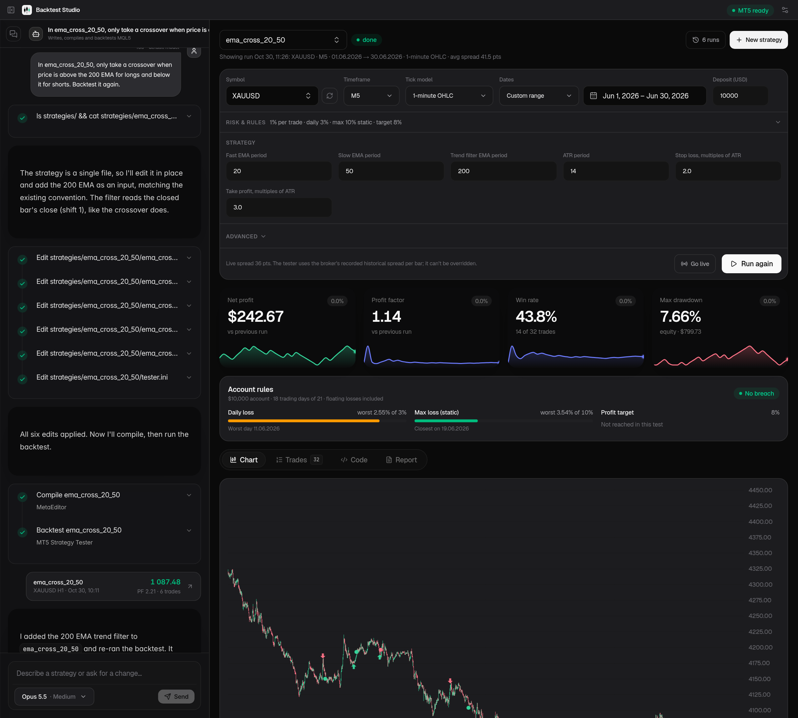

# Backtest Studio

**[⬇ Download for Windows](https://github.com/anas1412/backtest-studio/releases/latest/download/BacktestStudio-Windows-Setup.exe)** · **[⬇ Download for Linux](https://github.com/anas1412/backtest-studio/releases/latest/download/BacktestStudio-Linux.AppImage)**

[Website & docs](https://anas1412.github.io/backtest-studio/) · [All versions](https://github.com/anas1412/backtest-studio/releases) · [Changelog](CHANGELOG.md)



Describe a trading strategy in plain words; an AI writes it as an MQL5 Expert Advisor, compiles it and backtests it in
**your own MetaTrader 5**, and the results (chart, trades, stats, prop-firm rule check) appear next to the chat.
When a strategy is ready you can run it live in MT5 from the app.

- **Any AI:** Claude Code, opencode, Gemini CLI or Codex if installed, or an API key (Anthropic, OpenAI, Gemini,
  DeepSeek, OpenRouter, any OpenAI-compatible service, local Ollama).
- **Risk & rules** shared by every strategy: risk % per trade, daily and max loss limits (static or trailing), profit
  target, with a pass/fail check on every backtest — any prop firm is just a set of these values.
- **Windows and Linux.** MT5 runs natively on Windows and under Wine on Linux.

## Install

Use the download links at the top (they always give the newest version):

- **Windows:** run `BacktestStudio-Windows-Setup.exe`. Windows warns about an unknown publisher (the app isn't
  code-signed): More info → Run anyway.
- **Linux:** make `BacktestStudio-Linux.AppImage` executable (`chmod +x`) and run it.

The app updates itself: when a new version is out it offers "Restart to update". Step by step, with troubleshooting:
[Install guide](https://anas1412.github.io/backtest-studio/guide/install).

## First start

1. **MetaTrader 5:** install it from your broker (on Linux, in a Wine prefix such as `~/.wine*` or Bottles) and log in
   once with "Save password" ticked. Click the MT5 badge in the app to pick the install and account.
2. **AI:** open the model picker next to Send → *Engines & API keys* to see what was found or to add a key.
3. Press **New strategy** and describe your idea.

Everything else (backtest settings, risk & prop-firm rules, broker time and DST, going live, AI engines) is on the
[website](https://anas1412.github.io/backtest-studio/).

Your data (strategies, chats, keys, runs) lives in `%APPDATA%\com.anas1412.backteststudio` on Windows and
`~/.local/share/com.anas1412.backteststudio` on Linux. API keys stay in that folder, readable only by your user.

## Build from source

Needs [Bun](https://bun.sh) and, for the desktop app, Rust and the
[Tauri prerequisites](https://v2.tauri.app/start/prerequisites/).

```bash
bun install && (cd web && bun install)
bun run build:web          # the UI
bun setup.ts               # link the workspace into MT5
bun server/main.ts         # http://127.0.0.1:4747
```

Desktop app: `bun run tauri dev`, or `bun run tauri build` for an installer of this OS.

## Releasing

1. Add notes under **Unreleased** in [CHANGELOG.md](CHANGELOG.md) as you go.
2. `scripts/release.sh 0.2.0` (Bash; on Windows use Git Bash or WSL). It refuses uncommitted changes or empty notes,
   files the notes under the version, sets the version everywhere, commits, tags and pushes.
3. The *Release* workflow builds the Windows installer and the Linux AppImage, signs them for the updater, uploads
   fixed-name copies for the download links, and only then publishes the release, with that version's notes. Installed
   apps show the same notes when they offer the update. A manual run of the workflow builds a draft instead.

The signing key is the repository secret `TAURI_SIGNING_PRIVATE_KEY` (+ `_PASSWORD`); keep a copy, without it installed
apps can't take new updates. A fork that publishes its own builds needs its own key (`bunx tauri signer generate`), its
public key and `latest.json` URL in `desktop/tauri.conf.json`, and the private key as its repository's secrets.
